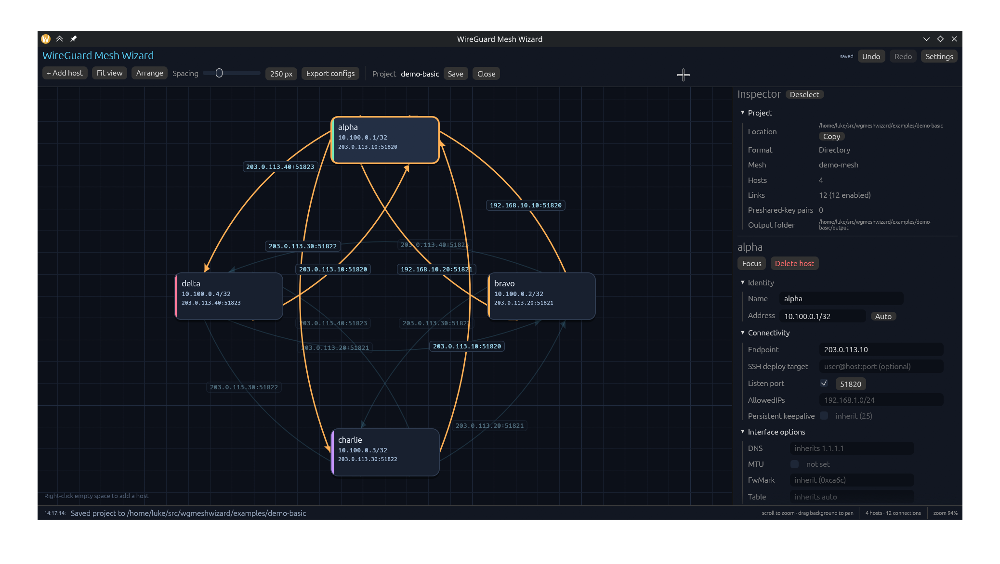

# WireGuard Mesh Wizard



A gui editor for WireGuard mesh networks, written in Rust with
[egui](https://github.com/emilk/egui).

All key generation is done with [x25519-dalek](https://github.com/dalek-cryptography/curve25519-dalek).

## Obvious disclaimer
The majority of code was generated by AI. All features and user-facing resources (like this README) were designed or written by a human.

## Settings file

User preferences are stored according to your environment:

- Linux: `$XDG_CONFIG_HOME/wgmeshwizard/settings.toml`, or
  `~/.config/wgmeshwizard/settings.toml`
- macOS: `~/Library/Application Support/wgmeshwizard/settings.toml`
- Windows: `%APPDATA%\wgmeshwizard\settings.toml`
- Override with `WGMESHWIZARD_SETTINGS=/path/to/settings.toml`

```toml
version = 1

[appearance]
theme = "system"   # system | dark | light
ui_scale = 1.0

[language]
locale = "system"  # system | en | ...

[mesh_view]
arrange_layout = "circle"  # circle | square | cards | rows
arrange_spacing = 60.0     # gap in canvas units between node cards when arranging
```
Invalid values are sanitized on load.

## Examples

- `examples/demo-basic`: small 4-way mesh
- `examples/demo-advanced`: big 9-way mesh that demonstrates endpoint variety,
  ListenPort overrides, per-link overrides, disabled links, preshared keys,
  deployment output, and host-specific options. See its [README](https://github.com/BluCobalt/wgmeshwizard/tree/master/examples/demo-advanced) for details.

## Project files

When launched without a project path, the app prompts you to open an existing
project or create a new one as either a folder or a `.wgm`/`.zip` archive.
Mesh data is saved only when you explicitly save; app settings are saved
automatically.

A project is either a directory of three CSV files, or a ZIP archive with the
same three files at its root. Both `.zip` and `.wgm` extensions are accepted.
The files are deliberately independent and human-readable so they can be edited like a spreadsheet.

### `mesh.csv`
One row of mesh defaults:

| Column | Meaning |
| --- | --- |
| `Version` | Version of the `mesh.csv` layout (currently `1`) |
| `MeshName` | Display name of the mesh |
| `AddressPrefix` | Network used to auto-number new hosts, e.g. `10.100.0.0/24` |
| `ListenPort` | Default WireGuard listen port (fallback `51820`) |
| `PersistentKeepalive` | Default keepalive in seconds |
| `FwMark`, `DNS`, `MTU`, `Table` | Default interface options |
| `PreUp`, `PostUp`, `PreDown`, `PostDown` | Default hooks |
| `SaveConfig` | `true`, `false`, or empty to leave unset |
| `AllowedIPs` | Extra routes inherited by hosts with no own value |
| `PresharedKeys` | `true` to generate and maintain one PSK per host pair |
| `GenerateHostsFile` | `true` to write an /etc/hosts-compatible file when exporting |
| `SearchDomain` | Domain appended to host names in the generated hosts file |
| `EnableDeployment` | `true` to write a static `deploy.sh` into the output directory |
| `SSHUser` | Default SSH user used by `deploy.sh` |
| `SSHPort` | Default SSH port used by `deploy.sh`; empty uses SSH's normal port |

### `hosts.csv`
One row per host:

| Column | Meaning |
| --- | --- |
| `ID` | Stable numeric identifier used by links |
| `Name` | Display name and configuration file stem |
| `X`, `Y` | Canvas position in world coordinates |
| `Address` | Interface address, e.g. `10.100.0.1/32` |
| `Endpoint` | Default public endpoint. A port typed here is moved into `ListenPort` automatically |
| `SSHTarget` | Optional `user@host:port` used by `deploy.sh` instead of `Endpoint` |
| `ListenPort` | Override for the mesh default |
| `PrivateKey` | Base64 X25519 private key |
| `AllowedIPs` | Extra routes advertised for this host |
| `PersistentKeepalive` | Override for the mesh default |
| `FwMark`, `DNS`, `MTU`, `Table` | Override for the mesh default |
| `PreUp`, `PostUp`, `PreDown`, `PostDown` | Override for the mesh default |
| `SaveConfig` | `true`, `false`, or empty to inherit |

Any optional fields inherit from mesh.csv.

### `links.csv`
One row per connection:

| Column | Meaning |
| --- | --- |
| `FromID`, `ToID` | Source and destination host IDs |
| `Enabled` | Include this direction in generated configs |
| `Endpoint` | Optional override; empty uses the target's `Endpoint`; `none` omits the line |
| `PresharedKey` | Optional base64 preshared key for this direction |

The app keeps a full mesh by adding links in both directions to all
existing hosts when new ones are added. Links can be disabled to omit a peer from generated configs.
When mesh-wide preshared keys are enabled, both directions of each pair share the
same key. Both directions are updated together.

Deleting a host also deletes all of its links.

### Generated hosts file

When `GenerateHostsFile` is enabled, exporting also writes a file named
`hosts` next to the generated `.conf` files. It contains one
`/etc/hosts`-compatible entry per host address:

```
10.100.0.1 alpha
10.100.0.2 bravo
```

When `SearchDomain` is set, each host name also gets a fully qualified alias:

```
10.100.0.1 alpha alpha.example.tld
10.100.0.2 bravo bravo.example.tld
```

Hosts without a parseable IP address are skipped. A host with several
addresses gets one line per address.

## Deployment script

When `EnableDeployment` is `true`, exporting also writes a self-contained
`deploy.sh` into the output directory. It embeds each host's rendered config
as readable text, along with its SSH destination and tunnel name, so the
script can be audited before it is run.

The SSH destination comes from `SSHTarget` when set, otherwise from the host's
`Endpoint` with the WireGuard port removed. Missing user and port values fall
back to the mesh-wide `SSHUser` and `SSHPort` defaults. If empty, `SSHPort`
is left to SSH. The remote user must be root or have passwordless
`sudo`.

```sh
# Preview what would happen
./output/deploy.sh --dry-run

# Deploy every config and apply the hosts block when available
./output/deploy.sh

# Deploy configs without changing /etc/hosts
./output/deploy.sh --no-hosts

# Do not install wireguard-tools automatically
./output/deploy.sh --no-install
```

For each host the script installs `wireguard-tools` when `wg-quick` is
missing, writes `/etc/wireguard/<tunnel>.conf`, and enables and restarts
`wg-quick@<tunnel>.service`. Tunnel names are shortened to the Linux
15-character interface limit when necessary.

When `GenerateHostsFile` is enabled, the script also applies the generated
records to `/etc/hosts` by default. Only the managed section is replaced:

```
### BEGIN WGMESHWIZARD HOSTS###
10.100.0.1 alpha alpha.example.tld
### END WGMESHWIZARD HOSTS###
```

Existing `/etc/hosts` content outside those markers is preserved.

Example output:
```aiignore
./deploy.sh --dry-run

WireGuard Mesh Wizard deployment
  Mesh:  advanced-demo
  Hosts: 9
  Mode:  dry run
  /etc/hosts: will be updated

[1/9] gateway
     target: admin@gw.mesh.example.net:2222
     tunnel: gateway (wg-quick@gateway.service)
  -> Dry run: no changes will be made
     would install /etc/wireguard/gateway.conf
     would enable and restart wg-quick@gateway.service
     would apply the WGMESHWIZARD hosts block to /etc/hosts
[ OK ] gateway (dry run)

[2/9] db-primary
     target: deploy@203.0.113.21:22
     tunnel: db-primary (wg-quick@db-primary.service)
  -> Dry run: no changes will be made
     would install /etc/wireguard/db-primary.conf
     would enable and restart wg-quick@db-primary.service
     would apply the WGMESHWIZARD hosts block to /etc/hosts
[ OK ] db-primary (dry run)

[3/9] db-replica
     target: dba@203.0.113.22:2200
     tunnel: db-replica (wg-quick@db-replica.service)
  -> Dry run: no changes will be made
     would install /etc/wireguard/db-replica.conf
     would enable and restart wg-quick@db-replica.service
     would apply the WGMESHWIZARD hosts block to /etc/hosts
[ OK ] db-replica (dry run)

[4/9] web-01
     target: deploy@[2001:db8:42::41]:22
     tunnel: web-01 (wg-quick@web-01.service)
  -> Dry run: no changes will be made
     would install /etc/wireguard/web-01.conf
     would enable and restart wg-quick@web-01.service
     would apply the WGMESHWIZARD hosts block to /etc/hosts
[ OK ] web-01 (dry run)

[5/9] web-02
     target: deploy@[2001:db8:42::42]:22
     tunnel: web-02 (wg-quick@web-02.service)
  -> Dry run: no changes will be made
     would install /etc/wireguard/web-02.conf
     would enable and restart wg-quick@web-02.service
     would apply the WGMESHWIZARD hosts block to /etc/hosts
[ OK ] web-02 (dry run)

[6/9] ops-laptop
     target: deploy@ops.example.net:22
     tunnel: ops-laptop (wg-quick@ops-laptop.service)
  -> Dry run: no changes will be made
     would install /etc/wireguard/ops-laptop.conf
     would enable and restart wg-quick@ops-laptop.service
     would apply the WGMESHWIZARD hosts block to /etc/hosts
[ OK ] ops-laptop (dry run)

[7/9] monitoring
     target: deploy@203.0.113.70:22
     tunnel: monitoring (wg-quick@monitoring.service)
  -> Dry run: no changes will be made
     would install /etc/wireguard/monitoring.conf
     would enable and restart wg-quick@monitoring.service
     would apply the WGMESHWIZARD hosts block to /etc/hosts
[ OK ] monitoring (dry run)

[8/9] branch-router
     target: root@[2001:db8:99::8]:2222
     tunnel: branch-router (wg-quick@branch-router.service)
  -> Dry run: no changes will be made
     would install /etc/wireguard/branch-router.conf
     would enable and restart wg-quick@branch-router.service
     would apply the WGMESHWIZARD hosts block to /etc/hosts
[ OK ] branch-router (dry run)

[9/9] backup
     target: deploy@backup.example.net:22
     tunnel: backup (wg-quick@backup.service)
  -> Dry run: no changes will be made
     would install /etc/wireguard/backup.conf
     would enable and restart wg-quick@backup.service
     would apply the WGMESHWIZARD hosts block to /etc/hosts
[ OK ] backup (dry run)

Deployment summary
  [ OK ] 9 host(s) checked
[ OK ] Dry run complete. No changes were made.
```

## License
This project is licensed under GPL-3-or-later.

## Credit
Inspired by [k4yt3x/wg-meshconf](https://github.com/k4yt3x/wg-meshconf).