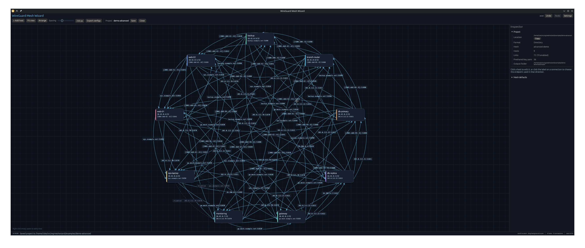

# Advanced demo

This is a feature-heavy mesh for trying the editor. It has 9 hosts in a nearly full mesh of directed links.

- Public endpoints that mix public IPs, DNS names, and bracketed IPV6 addresses
- Per-host `ListenPort` overrides (51821, 51822, 51841, 51850, 51870, 51880,
  and 51890), with other hosts inheriting the mesh default
- Per-connection endpoint overrides:
  - `gateway` ↔ `db-primary` use private `10.200.0.x` addresses
  - `ops-laptop` → `db-replica` uses `10.200.0.3:51999` as a port-forwarded
    path
  - `branch-router` ↔ `backup` use private IPv6 addresses
- `ops-laptop` ↔ `monitoring` is disabled
- Mesh-wide preshared keys, generated hosts-file output, and deployment
  script
- Host-specific SSH targets, `AllowedIPs`, keepalive, `FwMark`, DNS, MTU,
  routing table, firewall hooks, and `SaveConfig` overrides
- Mesh defaults for DNS, MTU, keepalive, and search domain

All keys in this example are demonstration-only and must not be used on a real
network.
